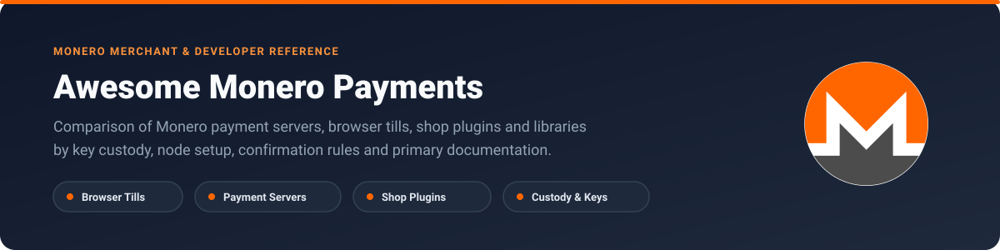
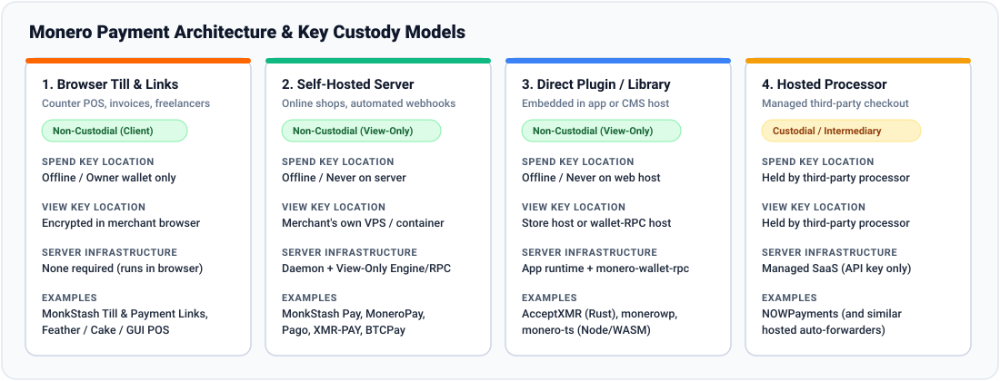
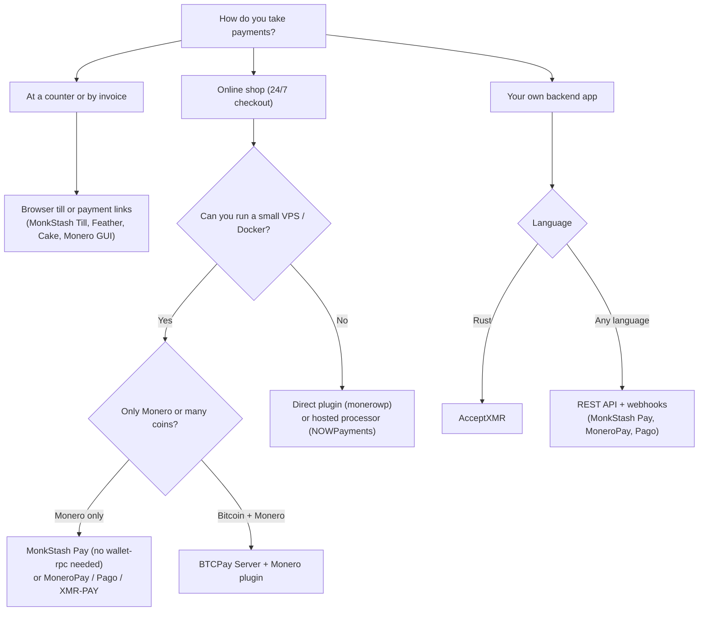

<p align="center">
  
</p>

# Awesome Monero Payments [](https://awesome.re) [](https://github.com/90ssolo/awesome-monero-payments/actions/workflows/validate.yml) [](LICENSE)

A practical comparison of **Monero (XMR) payment servers, browser tills, shop plugins and libraries** for merchants and developers.

Because Monero hides addresses and amounts on the blockchain, a shop cannot check payments by looking up a public address on a block explorer. Every tool that takes Monero has to scan blocks with a **view key** (in the browser, on your own server, or inside a library) or hand that job to a third party.

This list groups payment tools by how they handle keys and infrastructure, and records what each project's own code and documentation state as of the checked date. Where a project's docs do not answer a question, the field says `unknown`.

## Contents

- [How the setups differ](#how-the-setups-differ)
- [Comparison table](#comparison-table)
- [Detailed profiles](#detailed-profiles)
  - [1. Browser tills and local point-of-sale](#1-browser-tills-and-local-point-of-sale)
  - [2. Self-hosted payment servers](#2-self-hosted-payment-servers)
  - [3. Direct shop plugins and libraries](#3-direct-shop-plugins-and-libraries)
  - [4. Hosted processors](#4-hosted-processors)
- [Which setup fits your shop](#which-setup-fits-your-shop)
- [Things worth knowing before you take Monero](#things-worth-knowing-before-you-take-monero)
- [Related guides and tools](#related-guides-and-tools)
- [Notes on sources and disclosure](#notes-on-sources-and-disclosure)
- [Contributing](#contributing)

---

## How the setups differ

<p align="center">
  
</p>

| Setup | Spend key | View key | Needs a server? | Typical use |
|---|---|---|---|---|
| **1. Browser till / local wallet** | Yours only (kept offline or encrypted on the device) | On your phone, tablet or computer | No | Cafes, market stalls, counters, freelance invoices |
| **2. Self-hosted payment server** | Yours only (kept offline) | On your own VPS or container | Yes | Online shops that need 24/7 checkout and webhooks |
| **3. Direct shop plugin / library** | Yours only (kept offline) | On your web host or backend | Yes (your existing host + node/RPC) | WordPress shops without a separate container, or custom Rust/Node apps |
| **4. Hosted processor** | Held by the processor while settling | Held by the processor | No | Shops that trade privacy and self-custody for zero server upkeep |

---

## Comparison table

| Project | Type | Custody | Node / RPC needed | Fiat prices | Partial payments | Webhooks | Exports | License |
|---|---|---|---|---|---|---|---|---|
| **[MonkStash Browser Till & Payment Links](https://github.com/90ssolo/monkstash)** | Browser Till & Links | Non-custodial (Client) | monerod (direct or relay) | Yes (25+ currencies) | Yes | N/A (Client) | CSV (Sales/Requests) | `BSD-3-Clause` |
| **[Native Wallet URI & Subaddress POS (Monero GUI / Feather / Cake)](https://github.com/monero-project/monero-gui)** | Native Wallet POS | Non-custodial (Local) | monerod (local/remote) | Yes | Manual | No | CSV | `BSD-3-Clause / Open Source` |
| **[MonkStash Pay](https://github.com/90ssolo/monkstash/tree/main/apps/pay)** | Payment Server | Non-custodial (View-only) | monerod only (via WASM) | Yes (25+ currencies) | Yes | Signed HMAC | JSON / REST API | `BSD-3-Clause` |
| **[MoneroPay](https://github.com/moneropay/moneropay)** | Payment Server | Non-custodial (View-only) | monerod + wallet-rpc | Plugin-handled | Yes | Yes (HTTP POST) | Database / API | `AGPL-3.0` |
| **[Pago](https://github.com/dnvie/pago)** | Payment Server | Non-custodial (View-only) | monerod + wallet-rpc | Yes | Yes | Yes | unknown | `GPL-3.0` |
| **[XMR-PAY](https://github.com/SlowBearDigger/xmr-pay)** | Payment Server | Non-custodial (View-only) | monerod + wallet-rpc | Yes | Yes | Yes | unknown | `MIT` |
| **[BTCPay Server (Monero Plugin)](https://github.com/Kukks/BTCPayServerPlugin.Monero)** | Multi-Coin Suite | Non-custodial (View-only) | BTCPay + monerod + RPC | Yes | Yes | Signed HMAC | CSV & JSON | `MIT` |
| **[Monero Integrations (monerowp / WooCommerce)](https://github.com/monero-integrations/monerowp)** | Direct CMS Plugin | Non-custodial (View-only) | wallet-rpc / node | Yes | Yes | Native CMS Hooks | Via CMS | `MIT` |
| **[AcceptXMR](https://github.com/busyboredom/acceptxmr)** | Rust Library | Non-custodial (View-only) | monerod only | App-provided | Yes | Rust Channels | App-defined | `MIT` |
| **[NOWPayments](https://github.com/NowPaymentsIO)** | Hosted Processor | Custodial / Forwarding | None (SaaS) | Yes | Yes | Signed HMAC | CSV (Dashboard) | `Proprietary SaaS (Open-source API clients & CMS plugins)` |

---

## Detailed profiles

### 1. Browser tills and local point-of-sale

Tools that run on a phone, tablet or computer at the counter without a backend server. Good for in-person sales and one-off payment requests.

#### MonkStash Browser Till & Payment Links

> [!NOTE]
> **Disclosure:** Maintained by the MonkStash project (author of this catalogue).

| Field | Details |
|---|---|
| **Repository** | [https://github.com/90ssolo/monkstash](https://github.com/90ssolo/monkstash) |
| **Website / docs** | [https://monkstash.com/business](https://monkstash.com/business) |
| **Status** | Live (Browser wallet, till, and payment links are live; self-hosted Pay server listed separately below) |
| **How it runs** | Runs in the browser (hosted at wallet.monkstash.com or self-hosted via Docker/Next.js) |
| **Spend key** | Merchant only (optional view-only wallet mode on counter tablets so staff cannot spend) |
| **View key** | Merchant device only (encrypted in browser via Web Crypto AES-256-GCM; never sent to a server) |
| **Node / wallet-RPC** | monero-ts (WebAssembly) in browser via node relay or merchant's own monerod node (no monero-wallet-rpc required) |
| **Price conversion** | Yes (25+ fiat currencies converted to XMR; rate and source recorded on each sale) |
| **Invoices** | Fresh subaddress per sale; multi-till support (accounts 1–8 so up to 8 tills never reuse addresses); URL-fragment payment links (/pay#...) |
| **Confirmations** | Configurable presets: quick (0-conf up to 0.1 XMR, 1-conf up to 1 XMR, 10-conf above), standard (1-conf up to 5 XMR, 10-conf above), safe (10-conf) |
| **Partial payments** | Supported (tracks amount received vs. remaining balance due and overpayments per subaddress) |
| **Webhooks** | Not applicable (client-side browser till and shareable payment links; see MonkStash Pay for server webhooks) |
| **Exports** | Built-in client-side CSV exports for cashier sales, payment requests, and wallet history (UTF-8 BOM for spreadsheet compatibility) |
| **Integrations** | In-person counter till (tablet/phone), Shareable invoice links (/pay# fragment) |
| **License** | `BSD-3-Clause` |
| **Checked** | `2026-10-17` — [source](https://github.com/90ssolo/monkstash/blob/main/README.md), [source](https://monkstash.com/monero-pos), [source](https://monkstash.com/monero-payment-link) |

*Notes:* Payment link parameters are stored in the URL fragment (#), which browsers do not transmit to HTTP servers.

#### Native Wallet URI & Subaddress POS (Monero GUI / Feather / Cake)

| Field | Details |
|---|---|
| **Repository** | [https://github.com/monero-project/monero-gui](https://github.com/monero-project/monero-gui) |
| **Website / docs** | [https://github.com/monero-project/monero/blob/master/docs/URI_SCHEME.md](https://github.com/monero-project/monero/blob/master/docs/URI_SCHEME.md) |
| **Status** | Live (Production desktop and mobile wallets) |
| **How it runs** | Local desktop or mobile application installed on merchant device |
| **Spend key** | Merchant device (or offline cold wallet when paired with a view-only hot wallet) |
| **View key** | Merchant device only |
| **Node / wallet-RPC** | Local or remote monerod node (no monero-wallet-rpc required for interactive GUI use) |
| **Price conversion** | Built-in fiat display in Merchant/Receive views (varies by wallet client) |
| **Invoices** | Manual subaddress creation and standard monero: URI QR code generation (tx_amount, recipient_name, tx_description) |
| **Confirmations** | Visual mempool (0-conf) detection and block confirmation counter inspected by cashier |
| **Partial payments** | Manual inspection of incoming transfers to the subaddress |
| **Webhooks** | None (interactive wallet application) |
| **Exports** | CSV transaction history export supported in Monero GUI, Feather, and Cake Wallet |
| **Integrations** | In-person counter QR codes, Manual invoice URIs |
| **License** | `BSD-3-Clause / Open Source` |
| **Checked** | `2026-10-17` — [source](https://github.com/monero-project/monero/blob/master/docs/URI_SCHEME.md), [source](https://github.com/monero-project/monero-gui) |

*Notes:* Serves as the zero-dependency baseline for in-person merchants before adopting dedicated multi-till or automated invoice software.

### 2. Self-hosted payment servers

Small servers you run yourself with a **view-only wallet**. They hand out a fresh subaddress for every order, watch the chain, and send your shop a webhook when the payment arrives. Even if the server is compromised, it has no key to spend your coins.

#### MonkStash Pay

> [!NOTE]
> **Disclosure:** Maintained by the MonkStash project (author of this catalogue).

| Field | Details |
|---|---|
| **Repository** | [https://github.com/90ssolo/monkstash/tree/main/apps/pay](https://github.com/90ssolo/monkstash/tree/main/apps/pay) |
| **Website / docs** | [https://monkstash.com/monero-payment-gateway](https://monkstash.com/monero-payment-gateway) |
| **Status** | In testing (v0.1.0 in public repository; paired with WooCommerce plugin) |
| **How it runs** | Self-hosted Docker container or Node.js 22+ process with JSON persistence (no external database required) |
| **Spend key** | Merchant only (spend key never touches the server) |
| **View key** | Merchant's own server (configured via PAY_ADDRESS and PAY_VIEW_KEY) |
| **Node / wallet-RPC** | Connects directly to a Monero node (monerod via PAY_NODE_URL) using monero-ts WASM; does not require a separate monero-wallet-rpc service |
| **Price conversion** | Yes (25+ currencies; median of Bitfinex, Kraken, KuCoin with CoinGecko fallback and ECB reference rates; locked for 30 mins by default) |
| **Invoices** | Dedicated wallet account (PAY_ACCOUNT=1 by default) with unique subaddress per invoice, hosted checkout page, 3-minute expiry grace period, and subaddress lookahead gap monitoring (GET /api/health) |
| **Confirmations** | Configurable via PAY_CONFIRMATIONS: quick (0-conf <= 0.1 XMR, 1-conf <= 1 XMR, 10-conf > 1 XMR), standard (1-conf <= 5 XMR, 10-conf > 5 XMR), safe (10-conf) |
| **Partial payments** | Supported (tracks received, remaining, and overpaid amounts; emits invoice.partial and prompts customer for remaining balance until expiry) |
| **Webhooks** | HMAC-SHA256 signed webhooks (X-MonkStash-Signature) with 6 retry attempts for invoice.confirming, invoice.paid, invoice.partial, invoice.late, invoice.expired, and invoice.reverted |
| **Exports** | JSON invoice store (invoices.json with automatic backup) and REST API (GET /api/invoices/:id); no separate admin export UI in v0.1 |
| **Integrations** | WooCommerce (integrations/woocommerce in monorepo), JSON REST API (POST /api/invoices) |
| **License** | `BSD-3-Clause` |
| **Checked** | `2026-10-17` — [source](https://github.com/90ssolo/monkstash/blob/main/apps/pay/README.md), [source](https://monkstash.com/monero-payment-gateway), [source](https://monkstash.com/monero-woocommerce) |

*Notes:* Includes explicit subaddress lookahead gap tracking in GET /api/health and emits invoice.reverted if a 0-conf payment drops from the mempool.

#### MoneroPay

| Field | Details |
|---|---|
| **Repository** | [https://github.com/moneropay/moneropay](https://github.com/moneropay/moneropay) |
| **Website / docs** | [https://moneropay.eu](https://moneropay.eu) |
| **Status** | Documented active open-source project (v2 architecture) |
| **How it runs** | Self-hosted Go binary or Docker Compose stack with PostgreSQL/SQLite and monero-wallet-rpc |
| **Spend key** | Merchant (when monero-wallet-rpc is initialized with a view-only wallet; spend wallet only if merchant uses transfer endpoints) |
| **View key** | Merchant's own server (inside monero-wallet-rpc) |
| **Node / wallet-RPC** | Requires both monerod (local or remote) and monero-wallet-rpc |
| **Price conversion** | unknown (Core MoneroPay REST API accepts amounts in atomic piconero units; fiat conversion is delegated to storefront plugins) |
| **Invoices** | POST /receive creates a unique subaddress with expected atomic XMR amount and optional description |
| **Confirmations** | Configurable per request or query (returns covered.total and covered.unlocked balances; default 10-block unlock or custom confirmation check) |
| **Partial payments** | Supported (reports covered.total vs. expected amount in callbacks and GET /receive/:address) |
| **Webhooks** | HTTP POST callback to callback_url specified when creating the payment request |
| **Exports** | unknown (Database-backed persistence in PostgreSQL/SQLite; no built-in CSV export endpoint documented in core API) |
| **Integrations** | WooCommerce (community plugin), PrestaShop, REST API |
| **License** | `AGPL-3.0` |
| **Checked** | `2026-10-17` — [source](https://github.com/moneropay/moneropay) |

*Notes:* Lightweight Go daemon focused strictly on mapping subaddresses to expected atomic XMR balances and firing HTTP callbacks.

#### Pago

| Field | Details |
|---|---|
| **Repository** | [https://github.com/dnvie/pago](https://github.com/dnvie/pago) |
| **Website / docs** | [https://github.com/dnvie/pago](https://github.com/dnvie/pago) |
| **Status** | Documented open-source repository |
| **How it runs** | Self-hosted Docker / Node.js application |
| **Spend key** | Merchant only (designed for view-only wallet setup) |
| **View key** | Merchant's own server via wallet RPC |
| **Node / wallet-RPC** | monero-wallet-rpc connected to a Monero daemon |
| **Price conversion** | Yes (Supports fiat currency conversion on invoice creation) |
| **Invoices** | Generates per-invoice subaddress with configurable expiration window |
| **Confirmations** | Configurable confirmation threshold per invoice |
| **Partial payments** | Supported (tracks incoming transfers against invoice total) |
| **Webhooks** | HTTP webhook notifications with documented mock-payment testing utilities |
| **Exports** | unknown (Not explicitly documented in primary README) |
| **Integrations** | REST API, Custom webhook storefronts |
| **License** | `GPL-3.0` |
| **Checked** | `2026-10-17` — [source](https://github.com/dnvie/pago) |

*Notes:* Includes built-in mock payment simulation documented in its README to assist developer integration testing.

#### XMR-PAY

| Field | Details |
|---|---|
| **Repository** | [https://github.com/SlowBearDigger/xmr-pay](https://github.com/SlowBearDigger/xmr-pay) |
| **Website / docs** | [https://github.com/SlowBearDigger/xmr-pay](https://github.com/SlowBearDigger/xmr-pay) |
| **Status** | Documented open-source repository |
| **How it runs** | Self-hosted server / Docker deployment |
| **Spend key** | Merchant only (when configured with view-only wallet) |
| **View key** | Merchant's own server |
| **Node / wallet-RPC** | monero-wallet-rpc + monerod |
| **Price conversion** | Yes (Fiat-to-XMR rate conversion documented) |
| **Invoices** | Subaddress-based invoice generation and URI formatting |
| **Confirmations** | Configurable block confirmation count |
| **Partial payments** | Supported (tracks received balances per invoice) |
| **Webhooks** | HTTP webhook callbacks on invoice state updates |
| **Exports** | unknown |
| **Integrations** | REST API, Hosted checkout view |
| **License** | `MIT` |
| **Checked** | `2026-10-17` — [source](https://github.com/SlowBearDigger/xmr-pay) |

*Notes:* Documents Monero URI formatting and wallet compatibility behaviors.

#### BTCPay Server (Monero Plugin)

| Field | Details |
|---|---|
| **Repository** | [https://github.com/Kukks/BTCPayServerPlugin.Monero](https://github.com/Kukks/BTCPayServerPlugin.Monero) |
| **Website / docs** | [https://docs.btcpayserver.org/Monero/](https://docs.btcpayserver.org/Monero/) |
| **Status** | Active plugin maintained for BTCPay Server v2 |
| **How it runs** | Self-hosted Docker Compose stack (.NET BTCPay Server + PostgreSQL + NBXplorer + monerod + monero-wallet-rpc containers) |
| **Spend key** | Merchant only (view-only wallet imported into BTCPay Server) |
| **View key** | Merchant's own BTCPay Server instance (monero-wallet-rpc container) |
| **Node / wallet-RPC** | Requires full or pruned monerod container plus monero-wallet-rpc container |
| **Price conversion** | Yes (BTCPay multi-exchange rate engine and custom rate rules) |
| **Invoices** | Subaddress per invoice, hosted checkout UI, payment requests, and web Point-of-Sale app |
| **Confirmations** | Configurable per store (0-conf unconfirmed, 1-conf, or up to 10 confirmations) |
| **Partial payments** | Supported (detects partial payments and allows top-up within invoice window) |
| **Webhooks** | Signed BTCPay Greenfield API webhooks (InvoiceCreated, InvoiceReceivedPayment, InvoiceProcessing, InvoiceSettled, InvoiceExpired, InvoiceInvalid) |
| **Exports** | CSV and JSON invoice/payment exports via BTCPay Server back-office UI and Greenfield API |
| **Integrations** | WooCommerce, Shopify, Magento, PrestaShop, Drupal Commerce, Greenfield REST API |
| **License** | `MIT` |
| **Checked** | `2026-10-17` — [source](https://github.com/Kukks/BTCPayServerPlugin.Monero), [source](https://docs.btcpayserver.org/Monero/) |

*Notes:* Feature-complete enterprise suite, but carries higher RAM/CPU/disk overhead because it runs the full BTCPay .NET stack alongside Monero containers.

### 3. Direct shop plugins and libraries

Plugins that run inside your shop software (such as WordPress/PHP) and libraries you embed straight into your own backend.

#### Monero Integrations (monerowp / WooCommerce)

| Field | Details |
|---|---|
| **Repository** | [https://github.com/monero-integrations/monerowp](https://github.com/monero-integrations/monerowp) |
| **Website / docs** | [https://github.com/monero-integrations](https://github.com/monero-integrations) |
| **Status** | Public repositories with varying last-commit dates across platforms (verify CMS version compatibility before deploying) |
| **How it runs** | Installed directly inside WordPress / WooCommerce (PHP) or target CMS |
| **Spend key** | Merchant only (supports view-only address + view key mode or monero-wallet-rpc) |
| **View key** | WordPress / PHP server or connected monero-wallet-rpc host |
| **Node / wallet-RPC** | Either monero-wallet-rpc or view-key scanning depending on configured plugin mode |
| **Price conversion** | Yes (Fetches live exchange rates for storefront currency) |
| **Invoices** | Generates subaddress or integrated address per checkout order inside WooCommerce |
| **Confirmations** | Configurable confirmation count before transitioning WooCommerce order status |
| **Partial payments** | Tracks incoming transfers against order total during checkout window |
| **Webhooks** | Uses native internal WordPress/WooCommerce order lifecycle hooks (no external webhook server needed) |
| **Exports** | Relies on standard WooCommerce order CSV exports |
| **Integrations** | WooCommerce (monerowp), Magento, PrestaShop, OpenCart |
| **License** | `MIT` |
| **Checked** | `2026-10-17` — [source](https://github.com/monero-integrations/monerowp), [source](https://github.com/monero-integrations) |

*Notes:* Eliminates a separate payment middleware server, though storing view keys or RPC credentials directly inside a WordPress PHP environment requires careful host hardening.

#### AcceptXMR

| Field | Details |
|---|---|
| **Repository** | [https://github.com/busyboredom/acceptxmr](https://github.com/busyboredom/acceptxmr) |
| **Website / docs** | [https://docs.rs/acceptxmr/latest/acceptxmr/](https://docs.rs/acceptxmr/latest/acceptxmr/) |
| **Status** | Documented Rust crate on crates.io and GitHub |
| **How it runs** | Embedded as a Rust library inside a custom backend application, using sled or custom storage layer |
| **Spend key** | Merchant only (operates with private view key + primary address) |
| **View key** | Application server memory/config (scans blocks directly from monerod using view key) |
| **Node / wallet-RPC** | Connects to a Monero daemon (monerod RPC); does not require monero-wallet-rpc because it scans outputs using the view key and primary address directly |
| **Price conversion** | Not built-in (application calculates atomic piconero amount before creating an invoice) |
| **Invoices** | Creates subaddress invoices with configurable expiration height/time and custom state persistence |
| **Confirmations** | Configurable confirmation target per invoice with 0-conf mempool tracking |
| **Partial payments** | Supported (accumulates multiple outputs sent to the invoice subaddress and reports amount_paid vs. amount_requested) |
| **Webhooks** | In-process Rust subscriber channels / async streams (application can wrap these into HTTP webhooks) |
| **Exports** | Application-defined (exposes typed invoice structs via storage traits) |
| **Integrations** | Custom Rust backends and microservices |
| **License** | `MIT` |
| **Checked** | `2026-10-17` — [source](https://github.com/busyboredom/acceptxmr), [source](https://docs.rs/acceptxmr/latest/acceptxmr/) |

*Notes:* Scans transactions directly from a Monero daemon using the merchant's private view key without needing monero-wallet-rpc, and includes mock daemon utilities for testing.

### 4. Hosted processors

Third-party services that run the node and checkout page for you, in exchange for fees, third-party custody during payout, and visibility into your sales.

#### NOWPayments

| Field | Details |
|---|---|
| **Repository** | [https://github.com/NowPaymentsIO](https://github.com/NowPaymentsIO) |
| **Website / docs** | [https://nowpayments.io/supported-coins/monero-payments](https://nowpayments.io/supported-coins/monero-payments) |
| **Status** | Commercial live SaaS platform |
| **How it runs** | Hosted cloud API and plugins (merchant registers account and configures API + IPN secret) |
| **Spend key** | Intermediary / Custodial during processing (NOWPayments receives customer funds and forwards payouts to merchant wallet) |
| **View key** | Third-party processor (NOWPayments has full visibility into all invoices, amounts, and customer payments) |
| **Node / wallet-RPC** | None for merchant (managed by third party) |
| **Price conversion** | Yes (300+ crypto and fiat pairs with fixed-rate or floating-rate quotes) |
| **Invoices** | Hosted checkout URLs, API invoices, payment buttons, and PoS terminal links |
| **Confirmations** | Managed by processor (transitions through waiting, confirming, confirmed, sending, finished) |
| **Partial payments** | Supported (partially_paid status with options for manual resolution or top-up) |
| **Webhooks** | HMAC-SHA512 signed IPN (Instant Payment Notification) HTTP callbacks |
| **Exports** | CSV transaction history export via merchant web dashboard |
| **Integrations** | WooCommerce, Shopify, Magento 2, PrestaShop, OpenCart, WHMCS |
| **License** | `Proprietary SaaS (Open-source API clients & CMS plugins)` |
| **Checked** | `2026-10-17` — [source](https://nowpayments.io/supported-coins/monero-payments), [source](https://github.com/NowPaymentsIO) |

*Notes:* Included as a reference benchmark for the hosted processor trust model: zero server maintenance, but introduces service fees, third-party custody during settlement, and loss of merchant/customer metadata privacy.

---

## Which setup fits your shop



---

## Things worth knowing before you take Monero

1. **One subaddress per order.**
   Never match payments by amount alone—two customers can buy the same item at the same time. Give every order its own fresh subaddress (starts with `8` on mainnet) so you always know which order was paid.
2. **Keep accounts separate and watch the lookahead gap.**
   Monero wallets group subaddresses into numbered accounts (`0`, `1`, `2`...) and only scan 200 unused addresses ahead of the last paid one by default. Put your payment server on its own account (for example `PAY_ACCOUNT=1`) so it never hands out the same address as your desktop wallet or counter till. If your shop creates hundreds of unpaid invoices in a row, raise your wallet's `subaddress-lookahead` when restoring from seed.
3. **0-conf vs. confirmed payments.**
   An unconfirmed payment (`0-conf`, seen in the mempool within a few seconds) is fine when a customer is standing at your counter buying a coffee. Do not use `0-conf` for instant digital goods (downloads, gift cards, licence keys) or large orders—wait for 1 to 10 confirmations.
4. **Refunds need an address from the customer.**
   Monero uses one-time stealth addresses, so the sender's address is never on the blockchain. You cannot "send a refund back to the address it came from." Always ask the customer for a refund address and check proof of payment first.

---

## Related guides and tools

- **[Monero Merchant Starter Kit](https://github.com/90ssolo/monero-merchant-starter-kit):** Printable counter cards (`.svg`), invoice templates, cashier quick-start sheet, verification checklist, refund guide and daily sales CSV templates.
- **[Monero Public RPC Nodes](https://github.com/90ssolo/monero-rpc-nodes):** Checked Mainnet, Stagenet and Tor remote nodes with a script to test consensus and fee estimates.
- **[Official Monero URI Specification](https://github.com/monero-project/monero/blob/master/docs/URI_SCHEME.md):** How `monero:` payment links and QR codes are formatted.
- **[Accepting Monero as a Business](https://monkstash.com/accept-monero-payments):** Walkthrough of payment links, browser tills and self-hosted shop checkout.

---

## Notes on sources and disclosure

This repository is maintained by [MonkStash](https://monkstash.com). MonkStash's live browser till/payment links and its self-hosted payment server ([MonkStash Pay](https://github.com/90ssolo/monkstash/tree/main/apps/pay), currently in v0.1 testing) are listed using the same fields and rules as every other project.

Entries are compiled from each project's public code and documentation on the listed date, not from third-party audits or live transaction benchmarks.

---

## Contributing

To add a project or update an entry:

1. Edit [`data/gateways.yaml`](data/gateways.yaml) and link to the source documentation or code under `evidence.source_urls`.
2. Run `npm test` and `npm run build` to check the data and rebuild `README.md`.
3. Note any affiliation with the project in your pull request.

```bash
npm install
npm test
npm run build
```

## License

[CC0 1.0 Universal (Public Domain)](LICENSE).
